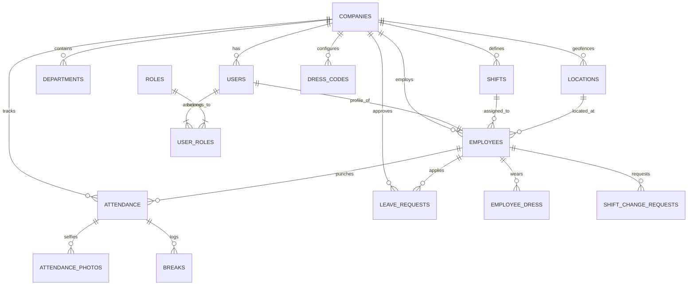

# Employee Workforce Management System – Database Documentation

## 1. Database Architecture & Design Principles

- **Engine:** MySQL 8.0+ (InnoDB)
- **Character Set:** `utf8mb4`
- **Collation:** `utf8mb4_unicode_ci`
- **Multi-Tenancy:** Schema isolation via mandatory `company_id` foreign key columns on all tenant-scoped operational tables.
- **Biometric Security:** Selfies saved to secure local disk (`uploads/selfies/`) and referenced via relative URIs and verified binary Base64 records.
- **Geolocation:** High-precision decimal coordinates (`DECIMAL(10,8)` for Latitude and `DECIMAL(11,8)` for Longitude) paired with radius thresholds in meters.

---

## 2. Entity-Relationship Diagram (ERD)

---

## 3. Database Table Definitions

### 3.1 `companies`
Root multi-tenant entity.
- `id` (BIGINT AUTO_INCREMENT PRIMARY KEY)
- `name` (VARCHAR(150) NOT NULL)
- `code` (VARCHAR(50) NOT NULL UNIQUE)
- `email` (VARCHAR(100) NOT NULL)
- `phone` (VARCHAR(30))
- `address` (VARCHAR(255))
- `logo_url` (VARCHAR(500))
- `is_active` (BOOLEAN DEFAULT TRUE)
- `created_at`, `updated_at` (TIMESTAMP)

### 3.2 `roles`
Role definitions: `ROLE_SUPER_ADMIN`, `ROLE_COMPANY_ADMIN`, `ROLE_HR_MANAGER`, `ROLE_EMPLOYEE`.
- `id` (BIGINT PRIMARY KEY)
- `name` (VARCHAR(50) UNIQUE NOT NULL)
- `description` (VARCHAR(255))

### 3.3 `users`
Base authentication account.
- `id` (BIGINT AUTO_INCREMENT PRIMARY KEY)
- `company_id` (BIGINT FK to `companies`, NULL for super admin)
- `employee_code` (VARCHAR(50) NOT NULL UNIQUE)
- `email` (VARCHAR(100) NOT NULL UNIQUE)
- `password_hash` (VARCHAR(255) NOT NULL - BCrypt standard)
- `first_name` (VARCHAR(100) NOT NULL)
- `last_name` (VARCHAR(100) NOT NULL)
- `phone` (VARCHAR(30))
- `avatar_url` (VARCHAR(500))
- `is_active` (BOOLEAN DEFAULT TRUE)

### 3.4 `departments`
- `id` (BIGINT AUTO_INCREMENT PRIMARY KEY)
- `company_id` (BIGINT NOT NULL FK)
- `name` (VARCHAR(100) NOT NULL)
- `code` (VARCHAR(30) NOT NULL)
- `description` (VARCHAR(255))
- `manager_id` (BIGINT FK to `users`)

### 3.5 `locations` (Office Geofences)
- `id` (BIGINT AUTO_INCREMENT PRIMARY KEY)
- `company_id` (BIGINT NOT NULL FK)
- `name` (VARCHAR(150) NOT NULL)
- `address` (VARCHAR(255) NOT NULL)
- `latitude` (DECIMAL(10,8) NOT NULL)
- `longitude` (DECIMAL(11,8) NOT NULL)
- `radius_meters` (DOUBLE DEFAULT 200.0)
- `is_active` (BOOLEAN DEFAULT TRUE)

### 3.6 `shifts`
- `id` (BIGINT AUTO_INCREMENT PRIMARY KEY)
- `company_id` (BIGINT NOT NULL FK)
- `name` (VARCHAR(100) NOT NULL)
- `shift_type` (VARCHAR(30) DEFAULT 'MORNING')
- `start_time` (TIME NOT NULL)
- `end_time` (TIME NOT NULL)
- `grace_period_minutes` (INT DEFAULT 15)
- `color_code` (VARCHAR(20) DEFAULT '#3b82f6')
- `is_active` (BOOLEAN DEFAULT TRUE)

### 3.7 `employees`
- `id` (BIGINT AUTO_INCREMENT PRIMARY KEY)
- `user_id` (BIGINT UNIQUE FK to `users`)
- `company_id` (BIGINT NOT NULL FK to `companies`)
- `department_id` (BIGINT FK to `departments`)
- `primary_location_id` (BIGINT FK to `locations`)
- `current_shift_id` (BIGINT FK to `shifts`)
- `designation` (VARCHAR(100) NOT NULL)
- `joining_date` (DATE NOT NULL)
- `employment_type` (VARCHAR(30) DEFAULT 'FULL_TIME')
- `work_status` (VARCHAR(30) DEFAULT 'OFFLINE')
- `emergency_contact_name` (VARCHAR(100))
- `emergency_contact_phone` (VARCHAR(30))

### 3.8 `attendance`
- `id` (BIGINT AUTO_INCREMENT PRIMARY KEY)
- `company_id` (BIGINT NOT NULL FK)
- `employee_id` (BIGINT NOT NULL FK)
- `shift_id` (BIGINT NOT NULL FK)
- `attendance_date` (DATE NOT NULL)
- `check_in_time` (DATETIME NOT NULL)
- `check_out_time` (DATETIME NULL)
- `check_in_latitude`, `check_in_longitude` (DECIMAL)
- `check_in_location_verified` (BOOLEAN DEFAULT FALSE)
- `check_in_distance_meters` (DOUBLE DEFAULT 0.0)
- `check_out_latitude`, `check_out_longitude` (DECIMAL)
- `check_out_location_verified` (BOOLEAN DEFAULT FALSE)
- `total_work_minutes` (INT DEFAULT 0)
- `total_break_minutes` (INT DEFAULT 0)
- `status` (VARCHAR(30) DEFAULT 'PRESENT')
- `is_late` (BOOLEAN DEFAULT FALSE)
- `late_minutes` (INT DEFAULT 0)
- `is_early_logout` (BOOLEAN DEFAULT FALSE)
- `early_logout_minutes` (INT DEFAULT 0)
- `notes` (TEXT)

### 3.9 `attendance_photos` (Live Biometric Selfies)
- `id` (BIGINT AUTO_INCREMENT PRIMARY KEY)
- `attendance_id` (BIGINT NOT NULL FK to `attendance`)
- `photo_type` (VARCHAR(20) NOT NULL: 'CHECK_IN' or 'CHECK_OUT')
- `photo_url` (VARCHAR(500))
- `photo_data_base64` (LONGTEXT)
- `captured_at` (DATETIME NOT NULL)
- `verified_by_hr` (BOOLEAN DEFAULT TRUE)
- `review_notes` (VARCHAR(255))

### 3.10 `dress_codes`
Weekly dress policy configured by company.
- `id` (BIGINT AUTO_INCREMENT PRIMARY KEY)
- `company_id` (BIGINT NOT NULL FK)
- `day_of_week` (VARCHAR(20) NOT NULL: 'MONDAY', 'TUESDAY', ...)
- `color_name` (VARCHAR(50) NOT NULL)
- `color_hex` (VARCHAR(20) NOT NULL)
- `description` (VARCHAR(255))
- `is_mandatory` (BOOLEAN DEFAULT TRUE)

### 3.11 `employee_dress`
- `id` (BIGINT AUTO_INCREMENT PRIMARY KEY)
- `company_id` (BIGINT NOT NULL FK)
- `employee_id` (BIGINT NOT NULL FK)
- `dress_date` (DATE NOT NULL)
- `selected_color_name` (VARCHAR(50) NOT NULL)
- `selected_color_hex` (VARCHAR(20) NOT NULL)
- `is_compliant` (BOOLEAN DEFAULT TRUE)
- `ai_verified` (BOOLEAN DEFAULT FALSE)
- `ai_confidence_score` (DOUBLE DEFAULT 0.95)

### 3.12 `breaks`
- `id` (BIGINT AUTO_INCREMENT PRIMARY KEY)
- `attendance_id` (BIGINT NOT NULL FK)
- `employee_id` (BIGINT NOT NULL FK)
- `break_type` (VARCHAR(30) NOT NULL: 'TEA_BREAK', 'LUNCH_BREAK', 'MEETING', 'PERSONAL')
- `start_time` (DATETIME NOT NULL)
- `end_time` (DATETIME NULL)
- `duration_minutes` (INT DEFAULT 0)

### 3.13 `leave_requests`
- `id` (BIGINT AUTO_INCREMENT PRIMARY KEY)
- `company_id` (BIGINT NOT NULL FK)
- `employee_id` (BIGINT NOT NULL FK)
- `leave_type` (VARCHAR(30) NOT NULL: 'SICK', 'CASUAL', 'ANNUAL', 'UNPAID')
- `start_date` (DATE NOT NULL)
- `end_date` (DATE NOT NULL)
- `total_days` (INT NOT NULL DEFAULT 1)
- `reason` (TEXT NOT NULL)
- `status` (VARCHAR(30) DEFAULT 'PENDING')
- `approved_by` (BIGINT FK to `users`)

### 3.14 `audit_logs`
- `id` (BIGINT AUTO_INCREMENT PRIMARY KEY)
- `company_id` (BIGINT NULL)
- `user_id` (BIGINT NULL)
- `action` (VARCHAR(100) NOT NULL)
- `entity_name` (VARCHAR(100) NOT NULL)
- `entity_id` (BIGINT)
- `details` (TEXT)
- `ip_address` (VARCHAR(50))
- `created_at` (TIMESTAMP DEFAULT CURRENT_TIMESTAMP)
